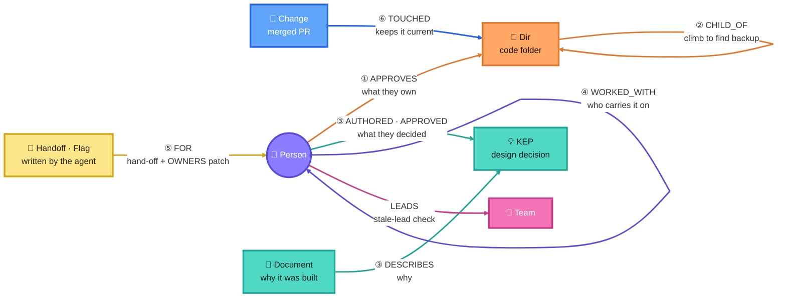

# Inheritance

**When someone leaves, what leaves with them?**

Inheritance is a company brain for departures. It maps who owns which code, who made which
design decisions and why, and who works with whom. It keeps that map current as ownership
changes. Then it answers questions and does the follow-up work:

- *Who do I ask about this file?* And who knows about this topic?
- *What did this person leave behind, and who carries it now?*
- *If this person, or this whole group, left tomorrow, what would go dark?* Then draft the
  hand-off and the ownership patch.
- *Why does this feature work this way, and who can still explain it?*
- *What changed this week?* And which records now disagree with each other?

It runs on **real, public data**: the governance records of the Kubernetes project, one of
the largest engineering organizations in open source. When a Kubernetes maintainer steps
away, their name moves to an `emeritus_approvers` list in the code's OWNERS file. So the
records hold real history of people leaving and of who took over. New ownership changes
land every week as merged pull requests, and Inheritance replays them into the graph live.

Built for **Graph Hacks** (FalkorDB × WeMakeDevs). **Track entered: Track 03, Company Brain.**

## Graph map



**How the agent walks it** when someone leaves (the numbers match the arrows):
1. **What they own:** follow `APPROVES` from the person to every code folder they approve.
2. **Who else can approve:** climb `CHILD_OF` up the folder tree to count the approvers left.
3. **What they decided:** follow `AUTHORED` / `APPROVED` to design decisions, and `DESCRIBES` to the reason behind each.
4. **Who carries it on:** rank their `WORKED_WITH` neighbors who already approve the same code.
5. **Act:** write a `Handoff` node, a hand-off note and an OWNERS patch.
6. **Stay current:** each merged PR becomes a `Change` that rewrites only the folders it `TOUCHED`.

<sub>🟣 people · 🟠 code · 🟢 design decisions · 🩷 teams · 🔵 live changes · 🟡 written by the agent · Simplified to the agent's main path; the full schema is in [Data model](#data-model).</sub>

**How the agent queries it.** Claude never writes Cypher. It picks one of 17 fixed tools, and
each tool is a graph query (full list and Cypher below):

| Question | Tool | What runs in FalkorDB |
|---|---|---|
| Who can approve this file? | `who_approves` | climb `CHILD_OF*` until a `Dir` with `APPROVES` edges |
| What leaves with this person? | `departure_impact` | their `APPROVES` dirs, count remaining approvers; their `AUTHORED/APPROVED` KEPs with nobody active left |
| Who carries it now? | `heirs` | rank active `WORKED_WITH` neighbours by edge weight, with the dirs they already approve |
| Who knows about X? | `who_knows`, `why` | full-text search on `Document`/`KEP`, then the people linked to them |
| Who is the real team? Who holds it together? | `shadow_teams`, `keystone_people` | `algo.labelPropagation`, `algo.betweenness` |
| What changed? | `recent_changes` | `Change`-`TOUCHED`->`Dir`, `Change`-`AFFECTED`->`Person` |
| Draft the hand-off | `draft_handoff` | the queries above, then writes `Handoff` nodes and an OWNERS patch |

**Where the decisions come from.** Every name and number in an answer comes from a tool
result, and the terminal prints each tool call as it runs. After each answer the agent prints a
receipt (tools called, queries, rows) and a grounding check that flags any name the graph did
not return. Run the same questions with `--no-graph` and the agent gets 0 of 19 facts right,
against 19 of 19 with the graph. See [Proving the graph does the work](#proving-the-graph-does-the-work).

## Why a graph

Knowledge in an organization lives in the connections between people, code and decisions:

- Code ownership is inherited down a folder tree. To find who may approve a file, you
  climb the tree until you reach an OWNERS file that names approvers. Some folders stop
  that inheritance.
- People are connected through the code they share and the decisions they made together.
  To find who carries a departed person's knowledge, you rank their neighbours.
- To find the real teams, as opposed to the org chart, you run community detection.
- To find the people who hold the organization together, you run betweenness centrality.
- When ownership changes, only the affected folders and connections need rewriting.

All of these are graph traversals or graph algorithms. The proof section below removes
each relationship type in turn and shows the answers change.

## What it found (Kubernetes, October 17, 2026)

| | |
|---|---|
| People in the records | 850: 263 active, 137 emeritus, 450 seen only on design decisions |
| Code areas with their own OWNERS file | 586, of which 149 list a former approver |
| Design decisions | 683 KEP files (679 distinct decisions), 675 with their design document loaded |
| **A real departure:** `lavalamp` | Emeritus on 31 code areas and on 39 design decisions. Nothing went dark: `deads2k`, `liggitt` and `sttts` already approve 22, 20 and 18 of those areas |
| **A departure that arrived live:** `rexagod` | [PR #142237](https://github.com/kubernetes/kubernetes/pull/142237), "Move myself to emeritus" (Oct 3), replayed into the graph: 30 code areas changed, and every one still has 6 approvers. The graph then flags that `rexagod` is still listed as SIG Instrumentation lead in sigs.yaml |
| **What if `thockin` left today?** | 137 code areas: 2 would have no local approver left and 8 would be down to one. 12 of 107 design decisions would have nobody active left who wrote or approved them, including IPVS load balancing and SCTP support. `draft_handoff` proposes a successor for each of the 10 at-risk areas and writes an OWNERS patch that `git apply` accepts |
| **…with `liggitt` and `deads2k` too?** | 239 areas, 34 down to one approver, 28 decisions with nobody left, and 3 leadership seats (Auth, API Machinery, Network) |
| Single points of failure | 46 areas whose own OWNERS file has exactly one active approver |
| Orphaned decisions | 4 of 298 implemented design decisions have no author or approver still active |
| Shadow teams | Label propagation finds groups that cut across official teams. One 48-person group centred on Node spans 8 official teams |
| Keystones (betweenness) | `deads2k`, `liggitt`, `thockin`, `sttts`, `dims` |

"Active" means currently listed as an approver, reviewer or team lead.

## Keeping knowledge current

The graph does not freeze at load time. It can start at any past date and then absorb
real ownership changes one merged PR at a time:

```bash
python -m inheritance.load --reset --as-of 2026-10-01   # the graph as it was on Oct 1
python -m inheritance.sync --list                       # 7 ownership PRs merged since
python -m inheritance.sync --steps 1                    # apply the next one: PR #142237
python -m inheritance.sync --verify                     # apply the rest, compare with a fresh load
```

For each merged PR that touched an OWNERS file or `OWNERS_ALIASES`, `sync`:

1. Reads only the changed files, at that commit. For an alias change, it works out which
   folders' owners actually differ.
2. Rewrites only those folders. That covers ownership edges, the folder tree when an
   OWNERS file is created or deleted, the `WORKED_WITH` weights, and people's status.
3. Records a `:Change` node with the PR number, date, title and link. It is connected to
   the folders it touched (`TOUCHED`) and the people it affected (`AFFECTED {how}`).

Answers then cite the PR that made them true. `who_approves` reports the latest ownership
change behind an answer. `departure_impact` reports departures absorbed this way, and
`recent_changes` lists them.

Replaying all 18 ownership PRs merged since August 20 gives exactly the same graph as a
fresh load at the pinned commit: 6,040 ownership edges, 585 tree edges, 586 folders, 850
statuses and 11,579 `WORKED_WITH` weights, all equal.

## It acts, and remembers

| Action | What it does | Written back to the graph |
|---|---|---|
| `draft_handoff(handle, also_leaving)` | For every area left with no approver or one, proposes a successor: someone who already reviews there, approves the nearest parent folder, or worked with the leaver. Lists decisions that need a new owner. Writes `out/handoffs/<handle>-<time>.md` and an OWNERS `.patch` that `git apply --check` accepts | `(:Handoff)-[:FOR]->(Person)`, `-[:PROPOSES {area}]->(Person)` |
| `route_question(question, path or topic)` | Sends a question to the right active expert, with a backup, and says why | `(:Question)-[:ROUTED_TO {role}]->(Person)` |
| `flag_stale_records()` | Finds places where the project's own records disagree, such as a lead who stepped back from all code ownership, or someone listed both as emeritus and as current in one OWNERS file | `(:Flag)-[:ABOUT]->(Person)` |
| `record_scenario(handle, note)` | Saves a what-if and its conclusion | `(:Scenario)-[:ABOUT]->(Person)` |

At the start of every session, the agent reads a timestamped brief of these memory nodes
and the latest synced changes from the graph. A later session knows which hand-off was
drafted, who a question went to, and what has changed since.

## Proving the graph does the work

`python scripts/prove_graph.py` runs these checks without an LLM and writes `docs/proof.json`.

| Check | Result |
|---|---|
| **With vs without FalkorDB**: the same 3 questions to the same model, with the graph tools and with none (`scripts/compare_graph.py`) | **19/19 expected facts with FalkorDB, 0/19 without.** 21 sources cited vs 2; all 63 names in the graph-backed answers came from the graph |
| **Keeping current**: load as of Aug 20, replay every ownership PR since, compare with a fresh load | **18 PRs, graph identical** on all five checks |
| **Integrity**: one `Dir` node per OWNERS file on disk, every edge type present | 586 = 586 |
| **Correctness**: for every file in kubernetes/kubernetes, the graph's "who approves this?" matches an independent walk over the raw OWNERS files | **31,441 of 31,441 files (100%)** |
| **Depth**: how far each answer lives from its file | 89% of files are governed by an OWNERS file in a folder above them, up to 10 levels up. For 1,829 files the nearest OWNERS file names no approvers, so the answer only exists by walking `CHILD_OF` edges |
| **Ablation**: delete one relationship type on a copy of the graph, then re-ask the 10 headline questions | every relationship type changes at least one answer (table below) |
| **Grounding**: every person, KEP and folder that an answer names must have been returned by FalkorDB, either in that session or in the graph-memory brief read at session start | an invented answer is flagged: `bgrant0607`, `KEP-9999`, `pkg/scheduler`. Real agent runs scored 27/27, 30/30 and 15/16 (the 16th was a fact recalled from an earlier session, now counted as "from graph memory") |
| **Receipts**: what FalkorDB does per tool | most tools take 2 to 17 queries and 10 to 85 ms; the algorithms take 0.5 to 1.7 s |

| Relationship removed | Answers that change |
|---|---|
| `CHILD_OF` (folder tree) | who approves core API validation, if thockin left, single points of failure (and, in some runs, shadow teams: label propagation can settle differently) |
| `APPROVES` | who approves kubelet code, who approves core API validation, if thockin left, single points of failure |
| `EMERITUS_OF` | what lavalamp left |
| `WORKED_WITH` | lavalamp's heirs, shadow teams, keystones |
| `AUTHORED` / `APPROVED` | what lavalamp left, if thockin left, who can explain sidecars, orphaned decisions |
| `LEADS` | if thockin left (leadership seats) |
| `OWNS` | shadow teams (official team membership) |

Every agent answer ends with a **graph receipt**, which is also saved to `out/receipts/`.
It lists the tool calls, Cypher queries, rows, time spent in FalkorDB and algorithms run,
plus the grounding score. Any name in the answer that did not come from the graph is listed:

```
── graph receipt ─────────────────────────────────────────────
4 tool calls · 29 Cypher queries · 206 rows · 109 ms in FalkorDB
   29 match
grounding: N/N names in the answer came back from FalkorDB this session ✓
──────────────────────────────────────────────────────────────
```

**With and without FalkorDB.** `python scripts/compare_graph.py` sends the same three questions
to the same model twice: once with the graph tools, once with no tools. It scores both answers:
- the expected facts it contains, computed from the graph by the tools and not by the model;
- how many names in it FalkorDB actually returned;
- how many sources it cites.

Both answers and the scores are written side by side to `docs/with_without.md`. For a single
question, `python -m inheritance.agent --no-graph "..."` runs the same control.

## Honest outcomes

Every tool reports what kind of answer it is:

- `answered`, with a path or source;
- `not_in_graph` and `not_in_repo`: the records do not contain it. This is reported as a
  gap, never as "nothing exists";
- `no_approvers_within_reach`: for example, with `max_climb=0`;
- `Unknown entity`: a handle that is not in the records, with similar handles suggested.

Ask about `postgres` and it says that is not in the graph. Ask who approves
`pkg/postgres/driver.go` and it says no such path exists in kubernetes/kubernetes at the
pinned commit.

## Responsible use

Inheritance answers **from** people's public record, with attribution. It never answers
**as** them. It does not imitate anyone's voice, and it does not guess why someone left.

- People are GitHub handles only. Names, employers and emails in `sigs.yaml` are never loaded.
- The agent refers to people by handle or as they/them.
- Every answer cites its source: the OWNERS file, the KEP, its design document or the PR.
- "What if X left" is a resilience exercise, not a prediction. Hand-offs and patches are
  proposals for the people involved.

## Data model

```
(:Person {handle, status: active|emeritus|unlisted})
(:Dir {path, no_parent_owners, labels, owners_file})-[:CHILD_OF]->(:Dir)       # OWNERS tree
(Person)-[:APPROVES|REVIEWS]->(Dir)                                             # current owners
(Person)-[:EMERITUS_OF]->(Dir)                                                  # former owners
(:Team {id, name, kind})           (Person)-[:LEADS {role}]->(Team)   (Person)-[:LED]->(Team)
(:Subproject {id, name})-[:PART_OF]->(Team)    (Subproject)-[:OWNS]->(Dir)
(:KEP {number, title, status, stage, milestone, created, path})                 # decisions
(KEP)-[:OWNED_BY]->(Team)   (KEP)-[:INVOLVES]->(Team)   (KEP)-[:REPLACES]->(KEP)
(Person)-[:AUTHORED|REVIEWED|APPROVED]->(KEP)
(:Document {kep, summary, motivation, alternatives, url})-[:DESCRIBES]->(KEP)   # the why
(Person)-[:WORKED_WITH {weight}]->(Person)    # +1 per shared OWNERS file, +0.5 per shared KEP
(:Source {repo, sha, date})                                                     # what the graph reflects
(:Change {sha, pr, date, title, url, files})-[:TOUCHED {kind}]->(Dir)           # synced PRs
(Change)-[:AFFECTED {how, path}]->(Person)
(:Handoff)-[:FOR]->(Person)   (Handoff)-[:PROPOSES {area}]->(Person)            # agent memory
(:Question)-[:ROUTED_TO {role}]->(Person)   (:Flag)-[:ABOUT]->(Person)   (:Scenario)-[:ABOUT]->(Person)
```

Full-text indexes on `KEP.title` and on `Document.summary`, `.motivation` and `.alternatives`.

| Source | What it gives | Pinned commit |
|---|---|---|
| `kubernetes/kubernetes`: every `OWNERS` file, `OWNERS_ALIASES`, and ~1,500 commits of history (trees only) | who may approve which code, including emeritus; the ownership changes replayed by `sync` | `98d0129` |
| `kubernetes/community` `sigs.yaml` | teams, leads, former leads, subprojects | `440e496` |
| `kubernetes/enhancements`: every `keps/**/kep.yaml` and `README.md` | design decisions, who made them, and their design documents | `6ebe0a9` |

All three are Apache 2.0.

## Key Cypher queries

All of these are in `inheritance/tools.py`, `inheritance/actions.py` and `inheritance/sync.py`.
The model never writes Cypher; it picks from these tools.

**Who approves a file.** Find the nearest OWNERS folder, then climb the tree, stopping at a
folder that sets `no_parent_owners`:

```cypher
MATCH (d:Dir) WHERE d.path = $p OR $p STARTS WITH (d.path + '/') OR d.path = '.'
RETURN d.path ORDER BY size(d.path) DESC LIMIT 1;

MATCH p = (d:Dir {path:$p})-[:CHILD_OF*0..25]->(a:Dir)
RETURN a.path, a.no_parent_owners, length(p) ORDER BY length(p);
```

**Departure impact.** For every area the leavers approve, find who is left, in one query.
Then find the decisions with nobody active left:

```cypher
MATCH (d:Dir) WHERE d.path IN $areas
OPTIONAL MATCH (x:Person {status:'active'})-[:APPROVES]->(d) WHERE NOT x.handle IN $gone
RETURN d.path, collect(x.handle);

MATCH (g:Person)-[:APPROVED|AUTHORED]->(k:KEP) WHERE g.handle IN $gone
WITH DISTINCT k
OPTIONAL MATCH (o:Person)-[:APPROVED|AUTHORED]->(k) WHERE NOT o.handle IN $gone AND o.status = 'active'
WITH k, collect(DISTINCT o.handle) AS still_here
RETURN k.number, k.title, k.status, k.path, still_here;
```

**Heirs.** Active people ranked by shared ownership and shared decisions, with the evidence:

```cypher
MATCH (p:Person {handle:$h})-[w:WORKED_WITH]-(x:Person {status:'active'})
RETURN x.handle, sum(w.weight) AS score ORDER BY score DESC, x.handle LIMIT $k;
```

**Who knows a topic.** Full-text search over decisions and design documents, traversed to
the active people on them, combined with the code folders that match:

```cypher
CALL db.idx.fulltext.queryNodes('Document', $q) YIELD node RETURN node.kep LIMIT 8;
MATCH (x:Person {status:'active'})-[r:AUTHORED|APPROVED|REVIEWED]->(k:KEP {number:$n}) RETURN x.handle, type(r), k.title;
MATCH (x:Person {status:'active'})-[r:APPROVES|REVIEWS]->(d:Dir) WHERE toLower(d.path) CONTAINS $tk RETURN x.handle, type(r), d.path;
```

**Keeping current.** Rewrite one folder's ownership in place and adjust the
collaboration weights:

```cypher
MATCH (d:Dir {path:$p}) SET d.no_parent_owners = $np, d.labels = $lb
WITH d OPTIONAL MATCH (:Person)-[r:APPROVES|REVIEWS|EMERITUS_OF]->(d) DELETE r;

UNWIND $rows AS r MATCH (a:Person {handle:r[0]}), (b:Person {handle:r[1]})
MERGE (a)-[w:WORKED_WITH]->(b) ON CREATE SET w.weight = 0.0 SET w.weight = w.weight + 1.0;

MATCH (c:Change)-[a:AFFECTED]->(:Person {handle:$h}) WHERE a.how IN ['removed_approver', 'moved_to_emeritus']
OPTIONAL MATCH (d:Dir {path:a.path}) OPTIONAL MATCH (x:Person {status:'active'})-[:APPROVES]->(d)
RETURN c.pr, c.date, c.url, a.path, collect(x.handle);
```

**Shadow teams.** Label propagation over each active person's 3 strongest collaborators:

```cypher
MATCH (a:Person {status:'active'})-[w:WORKED_WITH]-(b:Person {status:'active'})
WITH a, b, w.weight AS wt ORDER BY wt DESC
WITH a, collect(b)[0..3] AS top UNWIND top AS b CREATE (a)-[:ACTIVE_WITH]->(b);

CALL algo.labelPropagation({nodeLabels:['Person'], relationshipTypes:['ACTIVE_WITH'], maxIterations:30})
YIELD node, communityId RETURN node.handle, communityId;
```

**Keystones.** Betweenness centrality:

```cypher
CALL algo.betweenness({nodeLabels:['Person'], relationshipTypes:['ACTIVE_WITH'], samplingSize:100000, samplingSeed:7})
YIELD node, score RETURN node.handle, score ORDER BY score DESC LIMIT $k;
```

**Single points of failure** and **orphaned decisions**:

```cypher
MATCH (x:Person {status:'active'})-[:APPROVES]->(d:Dir)
WITH d, collect(x.handle) AS ap WHERE size(ap) = 1
OPTIONAL MATCH (c:Dir)-[:CHILD_OF*1..25]->(d)
RETURN d.path, ap[0], count(DISTINCT c) AS below ORDER BY below DESC;

MATCH (k:KEP) WHERE k.status = 'implemented'
MATCH (p:Person)-[:AUTHORED|APPROVED]->(k)
WITH k, collect(p.status) AS st WHERE NOT 'active' IN st RETURN k.number, k.title;
```

## The agent

`inheritance/agent.py` is a tool-use loop with Claude over 17 fixed tools:

- **Lookup:** `find_person` `whois` `who_approves` `who_knows` `why` `recent_changes`
- **Departures:** `departure_impact` `heirs`
- **Org health:** `single_points_of_failure` `orphaned_knowledge` `shadow_teams` `keystone_people` `flag_stale_records`
- **Actions:** `draft_handoff` `route_question`
- **Memory:** `record_scenario` `recall`

Every handle and path is checked against the graph. Bad input comes back as an error the
model can recover from. Every claim cites a source, and every answer gets a receipt and a
grounding check.

## Setup

Requires Docker, Python 3.10+ and git.

```bash
git clone https://github.com/kaushikkannan2/inheritance.git && cd inheritance
docker compose up -d                       # FalkorDB on :6379, browser on http://localhost:3000
python3 -m venv .venv && source .venv/bin/activate
pip install -r requirements.txt
./scripts/fetch_data.sh                    # sparse, blobless clones at pinned commits, ~40 s
python -m inheritance.load --reset         # builds the graph, ~10 s
./scripts/demo.sh                          # every demo beat without an LLM, ~25 s
python scripts/prove_graph.py              # the checks above, ~2 min
python scripts/compare_graph.py            # same questions with and without FalkorDB (needs an API key), ~3 min
```

Ask the agent (needs an Anthropic API key):

```bash
export ANTHROPIC_API_KEY=...               # user-level keys (sk-ant-usr-...) also need:
export ANTHROPIC_WORKSPACE_ID=wrkspc_...
python -m inheritance.agent                # interactive
python -m inheritance.agent "If thockin left tomorrow, what would go dark? Draft the hand-off."
python -m inheritance.agent --no-graph "If thockin left tomorrow, what would go dark?"   # control: no graph
```

Or call the tools directly: `python -m inheritance.cli --help`.

## Limits

- Who is active is read from OWNERS files and leadership lists, not from commit activity.
  Some people listed only on design decisions (450 "unlisted") may still be active.
- `sync` replays OWNERS changes. sigs.yaml and the KEPs are loaded at their pinned commits.
- `load --reset` clears memory nodes; `sync` keeps them.
- `WORKED_WITH` measures shared responsibility, not conversation.

## AI disclosure

This project was built with Claude Code (Anthropic) as a pair programmer. It wrote and
debugged much of the loader, sync, tools, agent and docs, under my direction and review.
At runtime, the agent uses Claude through the Anthropic API.

## License

Code: MIT. Data: Kubernetes project records, Apache 2.0.
